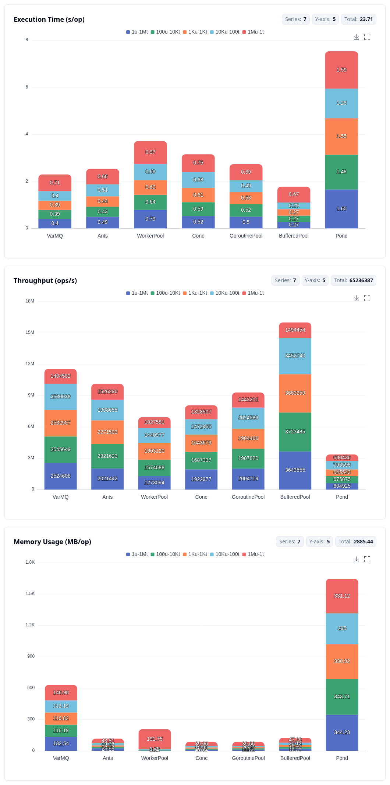
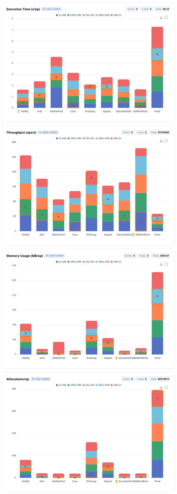
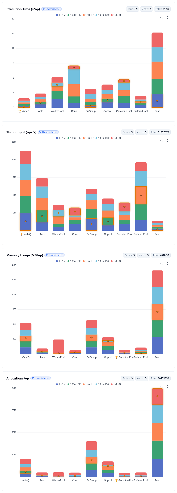

<div align="center">
<picture>
  <source media="(prefers-color-scheme: dark)" srcset="./assets/text-logo-dark.svg">
  
  <source media="(prefers-color-scheme: light)" srcset="./assets/text-logo.svg">
  
  
</picture>


  <p>
    <a href="https://github.com/avelino/awesome-go?tab=readme-ov-file#messaging"></a>
    <a href="https://pkg.go.dev/github.com/goptics/varmq"></a>
    <a href="https://github.com/goptics/varmq/actions/workflows/ci.yml"></a>
    <a href="https://codecov.io/gh/goptics/varmq"></a>
    <a href="https://varmq.goptics.org/bench-log"></a>
    <a href="https://golang.org/doc/devel/release.html"></a>
    <a href="LICENSE"></a>
  </p>

  <p>
    A typed worker pool and message queue for Go. Each worker is its own <a href="#concurrency">pool</a> and pulls jobs from any mix of sources: in-memory, priority, <a href="#persistent-and-distributed-queues">persistent and distributed</a> queues, or <a href="#topic-fan-out">topic</a> subscriptions. Go generics keep every job type-safe.
  </p>
  <p>
    Built for throughput: lock-free appends, <a href="#batched-dispatch">batched dispatch</a> and small in-memory jobs keep the hot path lean (<a href="#benchmarks">benchmarks</a>). Pause, stop, purge or resize a pool safely, inspect it over <a href="#rest-api">REST</a>, and plug in your own storage through <a href="#built-in-adapters">adapters</a>.
  </p>
</div>

## ✨ Features

- **⚡ High performance**: Optimized for high throughput with minimal overhead, even under heavy load. [see benchmarks](#benchmarks)
- **🛠️ Variants of queue types**:
  - Standard queues for in-memory processing
  - Priority queues for importance-based ordering
  - Persistent queues for durability across restarts
  - Distributed queues for processing across multiple systems
- **🧩 Worker abstractions**:
  - `NewWorker` - Fire-and-forget operations (most performant)
  - `NewErrWorker` - Returns only error (when result isn't needed)
  - `NewResultWorker` - Returns result and error
- **🚦 Concurrency control**: Fine-grained control over worker pool size, dynamic tuning and idle workers management
- **🧬 Multi Queue Binding**: Bind multiple queues to a single worker
- **📢 Topic Fan-out**: Publish once, every subscribed worker gets its own job from one shared log
- **💾 Persistence**: Support for durable storage through adapter interfaces
- **🌐 Distribution**: Scale processing across multiple instances via adapter interfaces
- **📡 REST API**: Built-in HTTP endpoints to inspect worker status and manage state (pause, resume, stop, restart)
- **🧩 Extensible**: Build your own storage adapters by implementing VarMQ's [internal queue interfaces](./assets/diagrams/interface.drawio.png)

## Quick Start

### Installation

```bash
go get github.com/goptics/varmq
```

### Basic Usage

```go
package main

import (
    "fmt"
    "time"

    "github.com/goptics/varmq"
)

func main() {
  worker := varmq.NewWorker(func(j varmq.Job[int]) {
    fmt.Printf("Processing %d\n", j.Data())
    time.Sleep(1 * time.Second)
  }) // default concurrency is 1
  defer worker.WaitUntilIdle()
  queue := worker.BindQueue()

  queue.Add(1)
  queue.Add(2)
}
```

↗️ **[Run it on Playground](https://go.dev/play/p/mobZd9pKcug)**

A single event loop sleeps until something signals it: `Add()` putting a job in the queue, or a worker finishing one. On each signal it hands jobs to workers while the queue has work and a worker slot is free, then goes back to waiting.


### Priority Queue

You can use priority queue to prioritize jobs based on their priority. `Lower number = higher priority`

```go
// just bind priority queue
queue := worker.BindPriorityQueue()

// add jobs to priority queue
for i := range 10 {
    queue.Add(i, i%2) // prioritize even tasks
}
```

↗️ **[Run it on Playground](https://go.dev/play/p/CHF8PVyrBI0)**

Jobs waiting in a priority queue are reordered, so a higher-priority job added later is dispatched first:


### Concurrency

```go
worker := varmq.NewWorker(func(j varmq.Job[int]) {
  fmt.Printf("Processing %d\n", j.Data())
  time.Sleep(500 * time.Millisecond)
}, 10) // with concurrency 10 or set 0 for parallelism
defer worker.WaitUntilIdle()
queue := worker.BindQueue()

for i := range 100 {
  queue.Add(i)
}
```

↗️ **[Run it on Playground](https://go.dev/play/p/uP0rA-NrzZB)**

Every `Add` (and every job in `AddAll`) tries to wake the event loop, but the signal channel holds only one pending signal, so the extra signals are simply dropped. One wake-up is enough: the loop keeps dispatching jobs back to back while the queue has work and a worker slot is free, and it hands each worker its share of the backlog in one go (a batch) rather than one job per wake-up.


> [!Note]
> Concurrency is a limit, not a pool size. A worker starts with a single goroutine and spawns more only while jobs are waiting, up to the limit. As the queue drains, the extra goroutines exit one by one, keeping one idle (or the share set by `varmq.WithMinIdleWorkerRatio`). To keep idle goroutines around for reuse, set `varmq.WithIdleWorkerExpiryDuration`: they are then removed only after sitting idle that long.

### Batched dispatch

Handing a job to a worker costs the event loop about the same whether the job takes a nanosecond or a minute. With many short jobs, handing them out one by one would keep the loop busier than the workers. So a worker can receive several jobs at once, a batch, and run them one after the other.

A batch holds the smallest of three numbers:

- **Fair share.** The waiting jobs split evenly across the workers, so every worker gets a job before any worker gets two.
- **What the loop needs.** VarMQ measures how long jobs take and gives each worker just enough that, all together, the workers come back for more about once every 32 µs. Until a job has been measured, a worker gets one at a time.
- **32**, the hard cap.

With enough jobs waiting, that works out to:

| Setup | Jobs per hand-off |
|---|---|
| 10 workers, 3 s jobs | 1, so jobs start in queue order |
| 24 workers, 1 ms jobs | 1 |
| 3,000 workers, 10 ms jobs | 10 |
| 10,000+ workers, 10 ms jobs | 32 |
| Concurrency 1, any jobs | up to 32: one worker runs jobs in order anyway |

So slow jobs go out one at a time and keep their order, and batches only grow when the loop would otherwise become the bottleneck. The job time comes from the last finished batch: if jobs suddenly get slower, one worker can still receive a batch sized for the old, fast jobs before the size adjusts.

Below, 8 cheap jobs with concurrency 2: the first worker takes 4, a second worker is started for 2, and the last 2 go out one at a time as workers free up.


**While jobs wait in a batch.** A worker runs its batch one job after another and tells the loop once, when the batch is done. Jobs still waiting their turn are `Queued`: `NumPending` counts them, `NumProcessing` does not, and you can still close them.

**On `Stop` or `Pause`.** Each worker finishes the job it is running and keeps the rest of its batch aside (parks them). Parked jobs stay `Queued`. `NumPending` counts them, but the queue's own `Len` does not, since they have already left the queue. On `Restart` or `Resume` they run first, in their original order. A `Purge` of their queue closes them at once.

**Capacity.** A queue's capacity limit counts only jobs still in the queue, not jobs in a batch or parked, so up to 32 more per worker can be pending.

**Which queues batch.**

| Queue | Batches? | Why |
|---|---|---|
| In-memory queue, topic | Yes | |
| Priority queue | No | A higher-priority job added later must not wait behind a batch. |
| Persistent or distributed queue | No | A worker must not hold unacknowledged messages that other consumers could take. |
| Worker bound to several queues | No | The strategy picks a queue for every single job. |

## 💡 Highlighted Features

### Persistent and Distributed Queues

VarMQ supports both persistent and distributed queue processing through adapter interfaces:

- **Persistent Queues**: Store jobs durably so they survive program restarts
- **Distributed Queues**: Process jobs across multiple systems

Usage is simple:

```go
// For persistent queues (with any IPersistentQueue adapter)
queue := worker.WithPersistentQueue(persistentQueueAdapter)

// For distributed queues (with any IDistributedQueue adapter)
queue := worker.WithDistributedQueue(distributedQueueAdapter)
```

See complete working examples in the [examples directory](./examples):

- [Persistent Queue Example (SQLite)](./examples/sqlite-persistent)
- [Persistent Queue Example (Redis)](./examples/redis-persistent)
- [Distributed Queue Example (Redis)](./examples/redis-distributed)

Create your own adapters by implementing the `IPersistentQueue` or `IDistributedQueue` interfaces.

> [!Note]
> Before testing examples, make sure to start the Redis server using `docker compose up -d`.

#### Built-in adapters

- ⚡ Redis: [redisq](https://github.com/goptics/redisq)
- 🗃️ SQLite: [sqliteq](https://github.com/goptics/sqliteq)
- 🦆 DuckDB: [duckq](https://github.com/goptics/duckq)
- 🐘 PostgreSQL: 🔄 Upcoming

### Multi Queue Binds

Bind multiple queues to a single worker, enabling efficient processing of jobs from different sources with configurable strategies. The worker supports four strategies:

1. **Priority** (default - prioritizes higher priority queues that have pending jobs)
2. **RoundRobin** (cycles through queues equally)
3. **MaxLen** (prioritizes queues with more jobs)
4. **MinLen** (prioritizes queues with fewer jobs)

```go
worker := varmq.NewWorker(func(j varmq.Job[string]) {
	fmt.Println("Processing:", j.Data())
	time.Sleep(500 * time.Millisecond) // Simulate work
}) // change strategy through using varmq.WithStrategy default is varmq.Priority
defer worker.WaitUntilIdle()

// Bind to a standard queues with coronological priorities
// You can change queue priority using varmq.WithQueuePriority function
q1 := worker.BindQueue()         // highest
q2 := worker.BindQueue()         // medium
pq := worker.BindPriorityQueue() // lowest

for i := range 15 {
	q2.Add(fmt.Sprintf("Task queue-2 %d", i))
}

for i := range 10 {
	pq.Add(fmt.Sprintf("Task priority-queue %d", i), i%2) // prioritize even tasks
}

for i := range 10 {
	q1.Add(fmt.Sprintf("Task queue-1 %d", i))
}
```

↗️ **[Run it on Playground](https://go.dev/play/p/0eL_0WNRVIh)**

The Source Manager picks which bound queue the next job comes from. With `varmq.WithStrategy(varmq.RoundRobin)` it takes turns across the queues and skips any that are empty:


### Topic (Fan-out)

A `Topic` is the opposite of multi queue binding: one producer, many workers. Publish once and every subscribed worker gets its own job. `Publish` returns `false` when no subscription is attached, the topic is closed, or it is full.

| | Queue | Topic |
|---|---|---|
| Who gets a job | each job is processed once, by one worker | every subscribed worker gets its own job |
| Storage | the job is removed once a worker takes it | the payload is stored once; each worker reads it with its own cursor, and it's freed after every worker has read it |
| Producer | `queue.Add(x)` | `topic.Publish(x)` |
| Late joiner | sees jobs still waiting in the queue | sees only what's published after it subscribed |

```go
topic := varmq.NewTopic[int]()

email := varmq.NewWorker(func(j varmq.Job[int]) {
  fmt.Printf("Emailing order %d\n", j.Data())
  time.Sleep(1 * time.Second)
}) // concurrency 1
stock := varmq.NewWorker(func(j varmq.Job[int]) {
  fmt.Printf("Updating stock for order %d\n", j.Data())
  time.Sleep(300 * time.Millisecond)
}, 2) // concurrency 2
defer email.WaitUntilIdle()
defer stock.WaitUntilIdle()

email.WithTopic(topic)
stock.WithTopic(topic)

for order := range 4 {
  topic.Publish(order) // both workers get all 4 orders
}
```

↗️ **[Run it on Playground](https://go.dev/play/p/NeIa69kRi5s)**

`Publish` stores the payload once in the topic's log and wakes every subscribed worker. Each subscription reads the log through its own cursor, so the fast stock worker runs ahead without waiting for the email worker. A payload stays in the log until every cursor has read it, and a chunk of the log is freed once the slowest cursor has moved past it:


### Result and Error Worker

VarMQ provides a `NewResultWorker` that returns both the result and error for each job processed. This is useful when you need to handle both success and failure cases.

```go
worker := varmq.NewResultWorker(func(j varmq.Job[string]) (int, error) {
 fmt.Println("Processing:", j.Data())
 time.Sleep(500 * time.Millisecond) // Simulate work
 data := j.Data()

 if data == "error" {
  return 0, errors.New("error occurred")
 }

 return len(data), nil
})
defer worker.WaitUntilIdle()
queue := worker.BindQueue()

// Add jobs to the queue (non-blocking)
if job, ok := queue.Add("The length of this string is 31"); ok {
 fmt.Println("Job 1 added to queue.")

 go func() {
  result, _ := job.Result()
  fmt.Println("Result:", result)
 }()
}

if job, ok := queue.Add("error"); ok {
 fmt.Println("Job 2 added to queue.")

 go func() {
  _, err := job.Result()
  fmt.Println("Result:", err)
 }()
}
```

↗️ **[Run it on Playground](https://go.dev/play/p/4jkGb9SAIrp)**

`NewErrWorker` is similar to `NewResultWorker` but it returns only error.

### Function Helpers

VarMQ provides helper functions that enable direct function submission similar to the `Submit()` pattern in other pool packages like [Pond](https://github.com/alitto/pond) or [Ants](https://github.com/panjf2000/ants)

- **`Func()`**: For basic functions with no return values - use with `NewWorker`
- **`ErrFunc()`**: For functions that return errors - use with `NewErrWorker`
- **`ResultFunc[R]()`**: For functions that return a result and error - use with `NewResultWorker`

```go
worker := varmq.NewWorker(varmq.Func(), 10)
defer worker.WaitUntilIdle()

queue := worker.BindQueue()

for i := range 100 {
    queue.Add(func() {
        time.Sleep(500 * time.Millisecond)
        fmt.Println("Processing", i)
    })
}
```

↗️ **[Run it on Playground](https://go.dev/play/p/J2xXmVlGYyW)**

> [!Important]
> Function helpers don't support persistence or distribution since functions cannot be serialized.

### REST API

VarMQ provides a built-in HTTP REST API for inspecting worker status and managing worker state remotely. Register the handler on any `http.Server` to expose endpoints:

```go
mux := http.NewServeMux()
mux.Handle("/varmq/", varmq.Handler("/varmq"))
http.ListenAndServe(":8080", mux)
```

Available endpoints:

| Method   | Path                                      | Description                  |
|----------|-------------------------------------------|------------------------------|
| `GET`    | `/health`                                 | Health check                 |
| `GET`    | `/workers`                                | List all workers (summary)   |
| `GET`    | `/workers/{name}`                         | Get worker details + metrics |
| `PATCH`  | `/workers/{name}/actions/{action}`        | Pause, resume, stop, restart |
| `PATCH`  | `/workers/{name}/config/concurrency/{n}`  | Adjust concurrency           |

> [!Warning]
> The REST API is unauthenticated by design. Protect it with middleware, network isolation, or a reverse proxy before exposing to untrusted networks.

## Benchmarks

```text
goos: linux
goarch: amd64
pkg: github.com/goptics/varmq
cpu: 13th Gen Intel(R) Core(TM) i7-13700
```

### `Add` Operation

Command: `go test -run=^$ -benchmem -bench '^(BenchmarkAdd)$' -cpu=1`

> Why use `-cpu=1`? Since the benchmark doesn’t test with more than 1 concurrent worker, a single CPU is ideal to accurately measure performance.

| Worker Type      | Queue Type     | Time (ns/op) | Memory (B/op) | Allocations (allocs/op) |
| ---------------- | -------------- | ------------ | ------------- | ----------------------- |
| **Worker**       | Queue          | 1,020        | 86            | 1                       |
|                  | Priority       | 1,057        | 64            | 1                       |
| **ErrWorker**    | ErrQueue       | 1,055        | 110           | 1                       |
|                  | ErrPriority    | 1,093        | 88            | 1                       |
| **ResultWorker** | ResultQueue    | 1,053        | 102           | 1                       |
|                  | ResultPriority | 1,093        | 80            | 1                       |

### `AddAll` Operation

Command: `go test -run=^$ -benchmem -bench '^(BenchmarkAddAll)$' -cpu=1`

| Worker Type      | Queue Type     | Time (ns/op) | Memory (B/op) | Allocations (allocs/op) |
| ---------------- | -------------- | ------------ | ------------- | ----------------------- |
| **Worker**       | Queue          | 144,307      | 86,163        | 1,004                   |
|                  | Priority       | 700,103      | 64,129        | 1,002                   |
| **ErrWorker**    | ErrQueue       | 171,741      | 126,701       | 1,507                   |
|                  | ErrPriority    | 745,010      | 104,669       | 1,505                   |
| **ResultWorker** | ResultQueue    | 181,409      | 143,299       | 1,007                   |
|                  | ResultPriority | 735,915      | 121,268       | 1,005                   |

> [!Note]
>
> `AddAll` benchmarks use a batch of **1000 items** per call. The reported numbers (`ns/op`, `B/op`, `allocs/op`) are totals for the whole batch. For per-item values, divide each by 1000.
> e.g. for default `Queue`, the average time per item is approximately **144ns**, against about **1,020ns** for a single `Add` followed by `Wait`.

Why is `AddAll` so much faster per item than individual `Add` calls?

1. **Batched dispatch**: with a thousand jobs queued at once, the event loop hands each worker its share of the backlog in one wake-up instead of one job per wake-up, so the hand-off cost is spread over the batch. In-memory FIFO queues and topics do this; priority queues deliberately take one job per hand-off (a higher-priority job must never wait behind a batch), which is why their `AddAll` gains much less.
2. **One wait, one group**: a single group job tracks the whole batch and the caller waits once, instead of a full enqueue, wake-up, run, wake-the-caller round trip per job.

### `Publish` Operation

Command: `go test -run=^$ -benchmem -bench '^(BenchmarkPublish)$' -cpu=1`

| Worker Type | Queue Type | Time (ns/op) | Memory (B/op) | Allocations (allocs/op) |
| ----------- | ---------- | ------------ | ------------- | ----------------------- |
| **Worker**  | Topic      | 126.8        | 76            | 1                       |

One worker subscribed to the topic. Unlike the `Add` benchmark, it does not wait for each job: it publishes `b.N` payloads and waits once at the end, so the number is per-payload throughput with batched dispatch, not a round trip.

### Comparison with Other Packages

The [benchmark repository](https://github.com/goptics/varmq-benchmarks) runs `VarMQ` against [ants](https://github.com/panjf2000/ants), [pond v2](https://github.com/alitto/pond), [conc](https://github.com/sourcegraph/conc), [workerpool](https://github.com/gammazero/workerpool) and two hand-rolled channel pools, across producer counts from one to a million, CPU-bound and I/O-bound tasks, and 4, 8 and 24 CPUs. `VarMQ` draws on some of Pond's design patterns and adds queue management and persistence on top.

**Feature comparison:**

| Feature                                   | VarMQ | ants | pond v2 | conc | workerpool |
| ----------------------------------------- | :---: | :--: | :-----: | :--: | :--------: |
| Generic (type-safe) API                   |  ✅   |  ✅  |   ✅    |  ✅  |     ❌     |
| Tasks return results and errors           |  ✅   |  ❌  |   ✅    |  ✅  |     ❌     |
| Task groups (submit many, wait once)      |  ✅   |  ❌  |   ✅    |  ✅  |     ❌     |
| Priority queue                            |  ✅   |  ❌  |   ❌    |  ❌  |     ❌     |
| Persistent queues (survive restarts)      |  ✅   |  ❌  |   ❌    |  ❌  |     ❌     |
| Distributed queues (across instances)     |  ✅   |  ❌  |   ❌    |  ❌  |     ❌     |
| Several queues bound to one pool          |  ✅   |  ❌  |   ❌    |  ❌  |     ❌     |
| Topic fan-out (publish once, many pools)  |  ✅   |  ❌  |   ❌    |  ❌  |     ❌     |
| Bounded queue, reject when full           |  ✅   |  ✅  |   ✅    |  ❌  |     ❌     |
| Pause and resume                          |  ✅   |  ❌  |   ❌    |  ❌  |     ✅     |
| Restart after stop                        |  ✅   |  ✅  |   ❌    |  ❌  |     ❌     |
| Resize pool at runtime                    |  ✅   |  ✅  |   ✅    |  ❌  |     ❌     |
| Cancel work via context                   |  ✅   |  ❌  |   ✅    |  ✅  |     ❌     |
| Panic recovery                            |  ✅   |  ✅  |   ✅    | ❌¹  |     ❌     |
| Task counters (submitted, failed, ...)    |  ✅   |  ❌  |   ✅    |  ❌  |     ❌     |
| Built-in REST API                         |  ✅   |  ❌  |   ❌    |  ❌  |     ❌     |

<sub>Based on each package's documentation as of October 2026: ants v2 (`PoolWithFuncGeneric`, `Tune`, `Reboot`, `PanicHandler`), pond v2 (`NewResultPool`, `NewGroup`, `Resize`, `WithQueueSize`), conc `pool`, workerpool v1 (`Pause(ctx)`). ¹ conc re-raises a task's panic from `Wait` by design.</sub>

### Performance

Each run submits 1M tasks to a pool of 50K workers in five producer patterns, from one producer with 1M tasks (`1u-1Mt`) to 1M producers with one task each (`1Mu-1t`). Seven pools take part: VarMQ, ants, pond v2, conc, workerpool, and two hand-rolled pools of fixed workers reading a channel (`GoroutinePool` unbuffered, `BufferedPool` with 1M slots). Measured on an i7-13700 with `GOMAXPROCS` set to 4, 8 and 24. The best value in each row is in bold; each workload name links to its live chart.

**Execution time (s, sum of the 5 producer patterns, lower is better)**

| CPUs | Workload | VarMQ | Ants | Pond | Conc | WorkerPool | GoroutinePool | BufferedPool |
| :--: | -------- | ---: | ---: | ---: | ---: | ---: | ---: | ---: |
| 4 | [I/O: sleep 10 ms](https://goptics.github.io/varmq-benchmarks/?d=2&g=0) | 2.29 | 2.53 | 7.52 | 3.15 | 3.71 | 2.74 | **1.77** |
| 4 | [CPU: loop of 10](https://goptics.github.io/varmq-benchmarks/?d=2&g=1) | **0.68** | 1.72 | 6.95 | 2.15 | 3.04 | 1.89 | 1.67 |
| 4 | [Mixed: loop 5 + sleep 5 ms](https://goptics.github.io/varmq-benchmarks/?d=2&g=2) | **2.13** | 2.46 | 7.35 | 3.36 | 3.98 | 2.82 | **2.13** |
| 8 | [I/O: sleep 10 ms](https://goptics.github.io/varmq-benchmarks/?d=1&g=0) | **1.65** | 2.43 | 7.81 | 3.25 | 4.70 | 2.65 | 1.72 |
| 8 | [CPU: loop of 10](https://goptics.github.io/varmq-benchmarks/?d=1&g=1) | **0.61** | 1.79 | 8.10 | 2.29 | 3.31 | 2.05 | 1.80 |
| 8 | [Mixed: loop 5 + sleep 5 ms](https://goptics.github.io/varmq-benchmarks/?d=1&g=2) | **1.28** | 2.32 | 7.29 | 3.11 | 4.74 | 2.56 | 1.92 |
| 24 | [I/O: sleep 10 ms](https://goptics.github.io/varmq-benchmarks/?d=0&g=0) | **1.93** | 2.92 | 12.79 | 5.54 | 6.78 | 4.66 | 3.36 |
| 24 | [CPU: loop of 10](https://goptics.github.io/varmq-benchmarks/?d=0&g=1) | **0.71** | 2.56 | 15.99 | 4.92 | 3.59 | 4.56 | 3.80 |
| 24 | [Mixed: loop 5 + sleep 5 ms](https://goptics.github.io/varmq-benchmarks/?d=0&g=2) | **1.33** | 2.63 | 17.99 | 6.29 | 5.63 | 5.22 | 3.22 |

**Throughput (M tasks/s, average of the 5 producer patterns, higher is better)**

| CPUs | Workload | VarMQ | Ants | Pond | Conc | WorkerPool | GoroutinePool | BufferedPool |
| :--: | -------- | ---: | ---: | ---: | ---: | ---: | ---: | ---: |
| 4 | [I/O: sleep 10 ms](https://goptics.github.io/varmq-benchmarks/?d=2&g=0) | 2.31 | 2.02 | 0.67 | 1.61 | 1.38 | 1.86 | **3.20** |
| 4 | [CPU: loop of 10](https://goptics.github.io/varmq-benchmarks/?d=2&g=1) | **8.12** | 2.96 | 0.74 | 2.41 | 1.76 | 2.72 | 3.16 |
| 4 | [Mixed: loop 5 + sleep 5 ms](https://goptics.github.io/varmq-benchmarks/?d=2&g=2) | 2.50 | 2.09 | 0.69 | 1.51 | 1.32 | 1.80 | **2.64** |
| 8 | [I/O: sleep 10 ms](https://goptics.github.io/varmq-benchmarks/?d=1&g=0) | 3.04 | 2.09 | 0.65 | 1.59 | 1.27 | 1.91 | **3.25** |
| 8 | [CPU: loop of 10](https://goptics.github.io/varmq-benchmarks/?d=1&g=1) | **8.65** | 2.82 | 0.66 | 2.22 | 1.67 | 2.53 | 2.91 |
| 8 | [Mixed: loop 5 + sleep 5 ms](https://goptics.github.io/varmq-benchmarks/?d=1&g=2) | **3.96** | 2.19 | 0.69 | 1.63 | 1.29 | 1.98 | 2.92 |
| 24 | [I/O: sleep 10 ms](https://goptics.github.io/varmq-benchmarks/?d=0&g=0) | **2.61** | 1.76 | 0.40 | 0.93 | 0.85 | 1.13 | 2.06 |
| 24 | [CPU: loop of 10](https://goptics.github.io/varmq-benchmarks/?d=0&g=1) | **9.08** | 2.10 | 0.32 | 1.08 | 1.49 | 1.16 | 1.62 |
| 24 | [Mixed: loop 5 + sleep 5 ms](https://goptics.github.io/varmq-benchmarks/?d=0&g=2) | **3.87** | 1.94 | 0.28 | 1.04 | 0.96 | 1.05 | 1.74 |

**Memory (MB allocated per pattern, average of the 5, lower is better)**

| CPUs | Workload | VarMQ | Ants | Pond | Conc | WorkerPool | GoroutinePool | BufferedPool |
| :--: | -------- | ---: | ---: | ---: | ---: | ---: | ---: | ---: |
| 4 | [I/O: sleep 10 ms](https://goptics.github.io/varmq-benchmarks/?d=2&g=0) | 132 | 24 | 345 | 18 | 43 | **17** | 26 |
| 4 | [CPU: loop of 10](https://goptics.github.io/varmq-benchmarks/?d=2&g=1) | 93 | **8** | 256 | 11 | 13 | 11 | 19 |
| 4 | [Mixed: loop 5 + sleep 5 ms](https://goptics.github.io/varmq-benchmarks/?d=2&g=2) | 119 | 17 | 339 | 16 | **15** | 16 | 24 |
| 8 | [I/O: sleep 10 ms](https://goptics.github.io/varmq-benchmarks/?d=1&g=0) | 131 | 23 | 351 | 18 | 55 | **17** | 26 |
| 8 | [CPU: loop of 10](https://goptics.github.io/varmq-benchmarks/?d=1&g=1) | 94 | **8** | 259 | 11 | 15 | 11 | 19 |
| 8 | [Mixed: loop 5 + sleep 5 ms](https://goptics.github.io/varmq-benchmarks/?d=1&g=2) | 118 | **16** | 344 | **16** | 17 | **16** | 24 |
| 24 | [I/O: sleep 10 ms](https://goptics.github.io/varmq-benchmarks/?d=0&g=0) | 132 | 22 | 353 | 17 | 61 | **16** | 27 |
| 24 | [CPU: loop of 10](https://goptics.github.io/varmq-benchmarks/?d=0&g=1) | 93 | **8** | 264 | 11 | 19 | 11 | 19 |
| 24 | [Mixed: loop 5 + sleep 5 ms](https://goptics.github.io/varmq-benchmarks/?d=0&g=2) | 118 | **15** | 346 | 16 | 18 | 16 | 24 |

Charts for the I/O workload, stacked by producer pattern. A chart's *Total* adds up the five patterns, while the throughput and memory tables above average them.

<details>
<summary><b>4 CPUs</b>: sleep 10 ms tasks, 50K workers</summary>

<picture>
  <source media="(prefers-color-scheme: dark)" srcset="./assets/bench/bench-4cpu-dark.png">
  
</picture>

[Open this chart live](https://goptics.github.io/varmq-benchmarks/?d=2&g=0)

</details>
<details>
<summary><b>8 CPUs</b>: sleep 10 ms tasks, 50K workers</summary>

<picture>
  <source media="(prefers-color-scheme: dark)" srcset="./assets/bench/bench-8cpu-dark.png">
  
</picture>

[Open this chart live](https://goptics.github.io/varmq-benchmarks/?d=1&g=0)

</details>
<details>
<summary><b>24 CPUs</b>: sleep 10 ms tasks, 50K workers</summary>

<picture>
  <source media="(prefers-color-scheme: dark)" srcset="./assets/bench/bench-24cpu-dark.png">
  
</picture>

[Open this chart live](https://goptics.github.io/varmq-benchmarks/?d=0&g=0)

</details>

For detailed performance comparisons and benchmarking results, visit:

- 📊 **[Benchmark Repository](https://github.com/goptics/varmq-benchmarks)** - Complete benchmark suite
- 📈 **[Interactive Charts](https://goptics.github.io/varmq-benchmarks/)** - Visual performance comparisons
- 📋 **[Bench Logs](https://goptics.github.io/varmq/bench-log/)** - Release benchmark tracking

## API Reference

For the complete package documentation, types, and method signatures, browse the **[GoDoc](https://pkg.go.dev/github.com/goptics/varmq)**.

## Star History

[](https://www.star-history.com/#goptics/varmq&Date)

## Contributing

Contributions are welcome! Please feel free to submit a Pull Request or open an issue.

Please note that this project has a [Code of Conduct](CODE_OF_CONDUCT.md). By participating in this project, you agree to abide by its terms.
